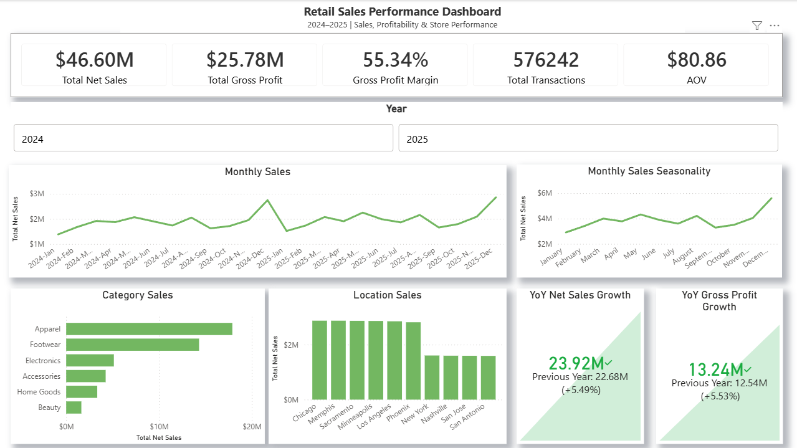
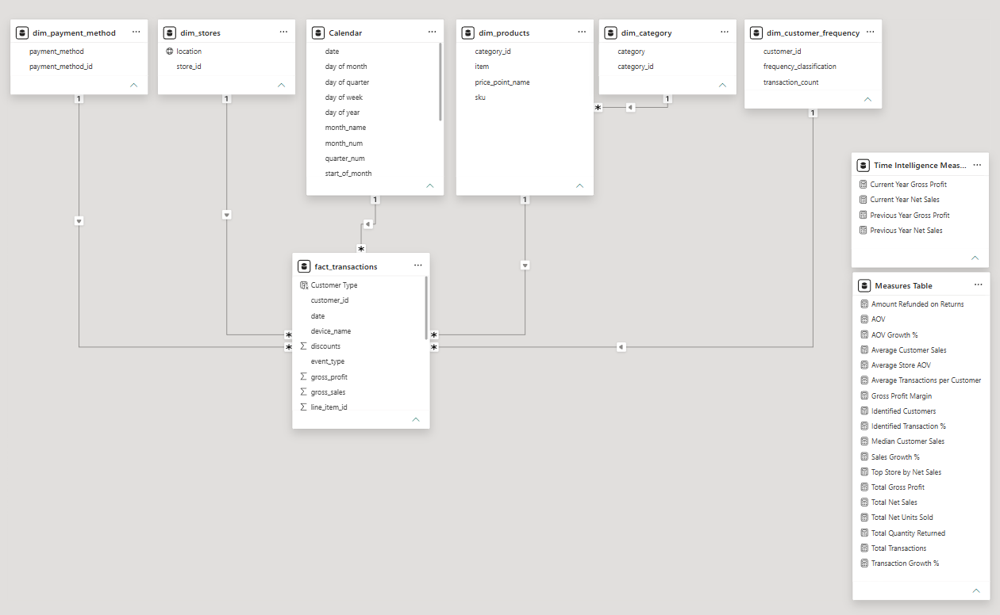
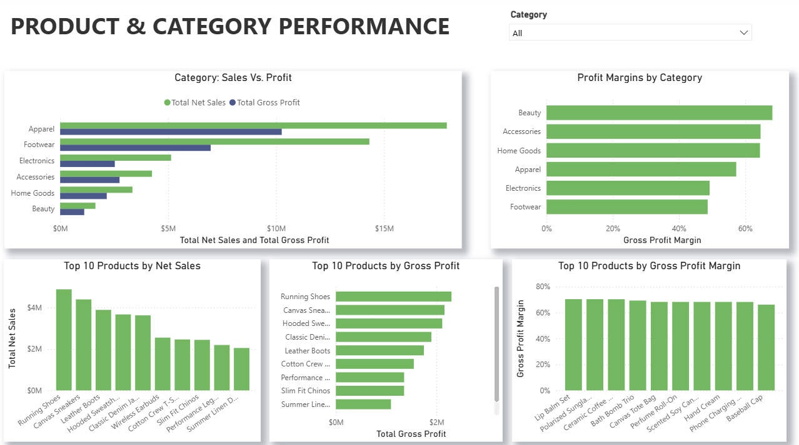
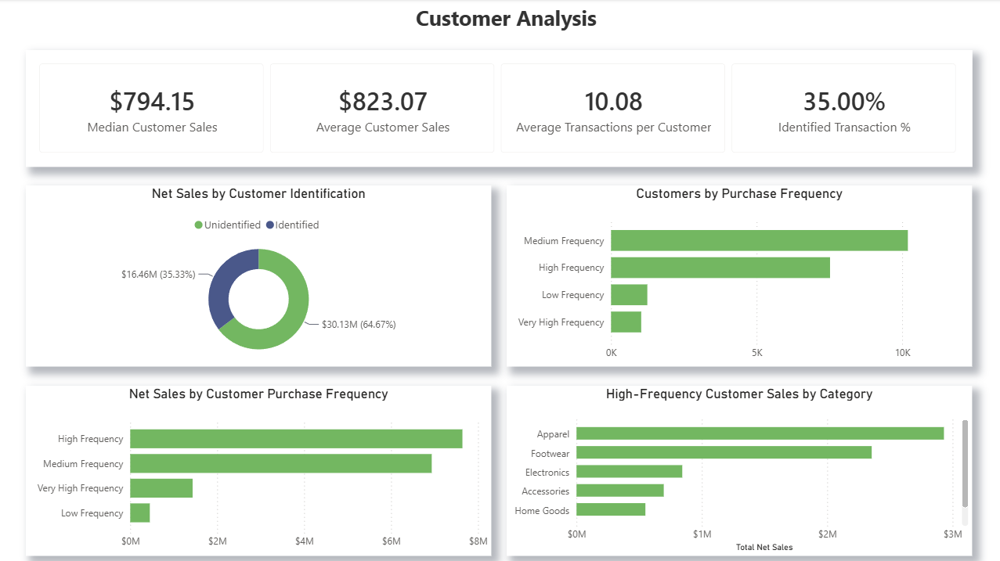
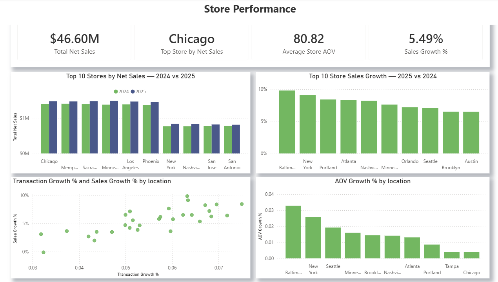
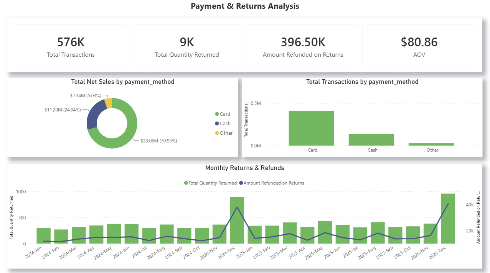
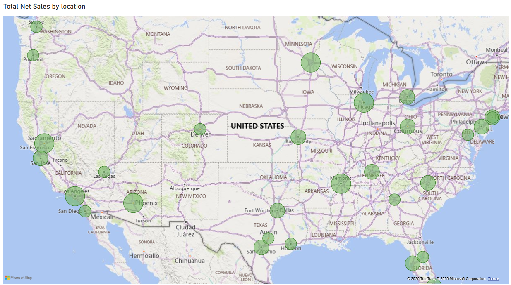

# Multi-Store Retail Analytics — SQL, Python & Power BI Analysis

## 📌 Project Overview

This project is an end-to-end analysis of a multi-store retail point-of-sale (POS) transaction dataset (~970,000+ line items across a 30-store network, 2024–2025). Raw data was cleaned and validated in Python (pandas), loaded into MySQL for business analysis, and modeled and visualized in Power BI. The SQL layer answers real business questions around overall performance, yearly trends, store performance, category and product performance, customer behavior, returns, and payment methods.

The project covers:

- Data cleaning & validation (Python / pandas)
- SQL data loading & validation
- Aggregations & KPIs
- CTEs (Common Table Expressions)
- Window functions (`RANK`, `SUM() OVER`, `ROW_NUMBER`)
- Business analytics queries with findings
- Star-schema data modeling in Power BI
- Dashboarding (Power BI)

## Table of Contents

- [Project Overview](#-project-overview)
- [Dashboard Preview](#-dashboard-preview)
- [Technologies Used](#️-technologies-used)
- [Setup Instructions](#setup-instructions)
- [Data Cleaning (Python / Jupyter Notebook)](#-data-cleaning-python--jupyter-notebook)
- [Database Schema](#-database-schema)
- [Business Questions, SQL Solutions & Findings](#-business-questions-sql-solutions--findings)
  - [1. Overall Business Performance](#-1-overall-business-performance)
  - [2. Yearly Performance](#-2-yearly-performance)
  - [3. Store Analysis](#-3-store-analysis)
  - [4. Category Analysis](#️-4-category-analysis)
  - [5. Product Analysis](#-5-product-analysis)
  - [6. Customer Analysis](#-6-customer-analysis)
  - [7. Returns & Refunds](#-7-returns--refunds)
  - [8. Payment Method Analysis](#-8-payment-method-analysis)
- [Power BI Data Model](#-power-bi-data-model)
- [Power BI Dashboard](#-power-bi-dashboard)
- [Key Insights](#-key-insights)
- [Author](#-author)

---

## 📊 Dashboard Preview

The SQL analysis below feeds a 6-page Power BI report built on a proper star-schema model (full data model and all 6 pages are further down in [Power BI Dashboard](#-power-bi-dashboard)). A preview of the executive page:



📄 One-page summary: [Retail POS Analysis Summary Report](Documentation/Retail_POS_Analysis_Summary_Report.pdf)

---

## ⚙️ Technologies Used

- Python (pandas, numpy) — data cleaning
- Jupyter Notebook
- MySQL / MySQL Workbench — data loading & analysis
- Power BI — data modeling & dashboarding
- Git & GitHub

---

## Setup Instructions

1. Run the cleaning steps in [Data Cleaning (Python / Jupyter Notebook)](#-data-cleaning-python--jupyter-notebook) against the raw CSV to produce a cleaned CSV.
2. Run the `CREATE DATABASE` / `CREATE TABLE` statements in [Database Setup](#database-setup) below.
3. Enable `local_infile` on your MySQL server/client.
4. Update the file path in the `LOAD DATA LOCAL INFILE` statement to point to your cleaned CSV, then run it.
5. Run the row count validation query to confirm all rows imported (~970,838 expected).
6. Run the remaining queries from [Business Questions, SQL Solutions & Findings](#-business-questions-sql-solutions--findings).
7. Connect Power BI to the MySQL database (or the cleaned CSV) and build out the star-schema model described in [Power BI Data Model](#-power-bi-data-model).

---

## 🐍 Data Cleaning (Python / Jupyter Notebook)

Before loading the data into MySQL, the raw 24-month POS export was cleaned and validated in a Jupyter notebook using pandas.

#### **Step 1:** Import libraries.

##### 👉 Purpose: Load the core libraries used for data cleaning.

```python
import pandas as pd
import numpy as np
from pathlib import Path
```

#### **Step 2:** Load the raw CSV.

##### 👉 Purpose: Read the raw 24-month POS export into a DataFrame.

```python
data_path = Path('PASTE THE FILE PATH HERE')
df = pd.read_csv(data_path)
```

#### **Step 3:** Standardize column names.

##### 👉 Purpose: Lowercase all column names and replace spaces with underscores for consistent, SQL-friendly naming.

```python
df.columns = df.columns.str.lower().str.replace(' ', '_')
```

#### **Step 4:** Initial inspection.

##### 👉 Purpose: Get familiar with the data — preview rows, check dimensions, count unique transactions, and review column data types.

```python
df.head()
df.shape
df['transaction_id'].nunique()
df.dtypes
```

#### **Step 5:** Convert date and time columns to proper types.

##### 👉 Purpose: Parse the `date` column as ISO8601 datetime and the `time` column (formatted like `14:30`) into a time object, so date/time logic works correctly downstream.

```python
df['date'] = pd.to_datetime(df['date'], format='ISO8601')
df['time'] = pd.to_datetime(df['time'], format='%H:%M').dt.time
```

#### **Step 6:** Check missing values and summary statistics.

##### 👉 Purpose: Identify which columns have missing data and review overall data types and numeric distributions.

```python
df.isnull().sum() * 100 / len(df)
df.info()
df.describe()
```

#### **Step 7:** Inspect negative quantities.

##### 👉 Purpose: Spot-check rows with a negative `qty`, which represent refunds, before deciding how to handle them.

```python
df[df['qty'] < 0]
```

#### **Step 8:** Validate the line-item distribution per transaction.

##### 👉 Purpose: Confirm that each `transaction_id` groups a sensible number of line items, and spot-check an individual transaction.

```python
df.groupby('transaction_id').count()

df_test = df['transaction_id'].value_counts().reset_index()
df_test['count'].value_counts()
df_test['count'].mean()

df[df['transaction_id'] == 'TXN1585688']
```

#### **Step 9:** Check discount validity.

##### 👉 Purpose: Make sure no row has a discount greater than or equal to its gross sales, which would indicate a data error.

```python
df[df['discounts'] >= df['gross_sales']]
df[['discounts', 'gross_sales']]
```

#### **Step 10:** Check for duplicate rows.

##### 👉 Purpose: Confirm there are no fully duplicated rows in the dataset.

```python
df[df.duplicated()]
```

#### **Step 11:** Validate calculated columns.

##### 👉 Purpose: Cross-check that `gross_sales`, `net_sales`, and `gross_profit` are internally consistent with their component columns (`qty`, `unit_price`, `discounts`, `unit_cost`).

```python
(df['qty'] * df['unit_price'] - df['gross_sales']).value_counts()
(df['gross_sales'] + df['discounts'] - df['net_sales']).value_counts()
df['net_sales'] - df['unit_cost'] * df['qty'] - df['gross_profit']
```

#### **Step 12:** Confirm `event_type` values and the quantity sign convention.

##### 👉 Purpose: Verify `event_type` only contains `Payment` and `Refund`, and that `Payment` rows always have a positive quantity while `Refund` rows are always negative.

```python
df['event_type'].unique()

df_test = df[df['event_type'] == 'Payment']
df_test['qty'].min()

df_test = df[df['event_type'] == 'Refund']
df_test['qty'].max()
```

#### **Step 13:** Check the maximum string length of each text column.

##### 👉 Purpose: Size the `VARCHAR` columns appropriately when creating the MySQL table.

```python
cols = ['time_zone',
'category',
'item',
'price_point_name',
'sku',
'payment_method',
'device_name',
'location',
'customer_id',
'event_type',
'transaction_id']

df[cols].apply(lambda x: x.str.len().max())
```

#### **Step 14:** Export the cleaned data.

##### 👉 Purpose: Write the cleaned DataFrame out to CSV so it can be loaded into MySQL.

```python
df.to_csv('Retail POS Data Cleaned.csv', index=False)
```
---

## 🧱 Database Schema

The SQL analysis runs against a single flat transactions table:

**Table: `transactions`**

| Column | Type | Description |
|---|---|---|
| `line_item_id` | INT (PK) | Auto-incrementing row identifier |
| `transaction_date` | DATE | Date of the transaction |
| `transaction_time` | TIME | Time of the transaction |
| `timezone` | CHAR(3) | Timezone code |
| `category` | VARCHAR(50) | Product category |
| `item` | VARCHAR(50) | Product/item name |
| `quantity` | INT | Units sold (negative for refunds) |
| `price_point_name` | VARCHAR(50) | Price point/variant label |
| `sku` | VARCHAR(50) | Stock keeping unit |
| `unit_price` | DECIMAL(12,2) | Price per unit |
| `gross_sales` | DECIMAL(12,2) | Sales before discounts |
| `discount` | DECIMAL(12,2) | Discount applied |
| `net_sales` | DECIMAL(12,2) | Sales after discounts |
| `tax` | DECIMAL(12,2) | Tax collected |
| `total_collected` | DECIMAL(12,2) | Total amount collected (net sales + tax) |
| `transaction_id` | VARCHAR(50) | Groups line items into a single transaction |
| `payment_method` | VARCHAR(50) | Payment method used |
| `device_name` | VARCHAR(50) | POS device identifier |
| `location` | VARCHAR(50) | Store/location name |
| `customer_id` | VARCHAR(50) | Customer identifier (nullable — unidentified customers) |
| `event_type` | VARCHAR(50) | `Payment` or `Refund` |
| `unit_cost` | DECIMAL(12,2) | Cost per unit |
| `gross_profit` | DECIMAL(12,2) | Profit after cost of goods |

For Power BI, this same data is remodeled into a star schema — see [Power BI Data Model](#-power-bi-data-model).


### Database Setup

```sql
CREATE DATABASE retail_analytics;
USE retail_analytics;

CREATE TABLE transactions (
    line_item_id INT AUTO_INCREMENT PRIMARY KEY,
    transaction_date DATE,
    transaction_time TIME,
    timezone CHAR(3),
    category VARCHAR(50),
    item VARCHAR(50),
    quantity INT,
    price_point_name VARCHAR(50),
    sku VARCHAR(50),
    unit_price DECIMAL(12 , 2 ),
    gross_sales DECIMAL(12 , 2 ),
    discount DECIMAL(12 , 2 ),
    net_sales DECIMAL(12 , 2 ),
    tax DECIMAL(12 , 2 ),
    total_collected DECIMAL(12 , 2 ),
    transaction_id VARCHAR(50) NOT NULL,
    payment_method VARCHAR(50),
    device_name VARCHAR(50),
    location VARCHAR(50),
    customer_id VARCHAR(50),
    event_type VARCHAR(50),
    unit_cost DECIMAL(12 , 2 ),
    gross_profit DECIMAL(12 , 2 )
);

-- Run this in the command line for a quicker import.
-- Make sure local_infile is enabled before running this.

LOAD DATA LOCAL INFILE 'PASTE THE FILE PATH TO CLEAN DATA.csv'
INTO TABLE transactions
FIELDS TERMINATED BY ','
OPTIONALLY ENCLOSED BY '"'
LINES TERMINATED BY '\n'
IGNORE 1 ROWS
(
transaction_date,
transaction_time,
timezone,
category,
item,
quantity,
price_point_name,
sku,
unit_price,
gross_sales,
discount,
net_sales,
tax,
total_collected,
transaction_id,
payment_method,
device_name,
location,
customer_id,
event_type,
unit_cost,
gross_profit
);
```

---

## 📊 Business Questions, SQL Solutions & Findings

Dataset: Multi-Store Retail POS · Analysis period: 2024–2025 · Database: `retail_analytics` · Table: `transactions`

### 📊 1. Overall Business Performance

#### **Query 01:** Validate all rows were imported.

##### 👉 Purpose: Confirm the row count matches the source file before doing any analysis.

```sql
SELECT 
    COUNT(*)
FROM
    transactions;
```

📌 **Finding:** Expected dataset size is 970,838 transaction line items.

#### **Query 02:** Validate `customer_id` null transformation.

##### 👉 Purpose: Confirm the number of unique payment transactions after `customer_id` cleaning.

```sql
SELECT 
    COUNT(DISTINCT transaction_id) AS total_transactions
FROM
    transactions
WHERE
    event_type = 'Payment';
```

#### **Query 03:** Validate transaction line distribution.

##### 👉 Purpose: Check how many line items a typical order contains.

```sql
WITH line_items AS(
	SELECT 
		transaction_id, COUNT(transaction_id) AS transactions
	FROM
		transactions
	WHERE
		event_type = 'Payment'
	GROUP BY transaction_id
)
SELECT 
    COUNT(transaction_id) AS customer_count, transactions
FROM
    line_items
GROUP BY transactions;
```

📌 **Finding:** Transactions are multi-line orders: a317,999 orders have 1 line item, 160,319 have 2, 68,944 have 3, and 28,980 have 4. The average order contains approximately 1.67 line items.

#### **Query 04:** Validate refund quantities.

##### 👉 Purpose: Confirm the sign convention used for refunds before running refund-related calculations.

```sql
SELECT 
    quantity
FROM
    transactions
WHERE
    event_type = 'Refund'
GROUP BY quantity;
```

📌 **Finding:** Refund transactions use negative quantities, allowing refunds to be incorporated naturally into net-unit calculations.

#### **Query 05:** Overall financial totals.

##### 👉 Purpose: Get a first look at aggregate sales, discount, tax, and profit figures.

```sql
SELECT 
    SUM(gross_sales) AS gross_sales,
    SUM(discount * - 1) AS discount,
    SUM(net_sales) AS net_sales,
    SUM(tax) AS tax,
    SUM(total_collected) AS total_collected,
    SUM(gross_profit) AS gross_profit
FROM
    transactions;
```

📌 **Finding:** The dataset generates $46.60M in net sales and $25.78M in gross profit across the two-year period.

#### **Query 06:** Validate gross profit calculation.

##### 👉 Purpose: Validate the relationship between collected revenue, tax, product cost, and gross profit at the line-item level.

```sql
WITH total_cte AS (
	SELECT 
		line_item_id, total_collected, quantity * unit_cost AS total_cost, tax,
        gross_profit
	FROM
		transactions
)
SELECT
total_collected - total_cost - tax as new_gross_profit, gross_profit
from total_cte;
```

#### **Query 07:** Total payment transactions.

##### 👉 Purpose: Establish the authoritative transaction count for the analysis period.

```sql
SELECT 
    COUNT(DISTINCT transaction_id) AS total_transactions
FROM
    transactions
WHERE
    event_type = 'Payment';
```

📌 **Finding:** The authoritative final transaction count is 576,242 payment transactions.

#### **Query 08:** Total net units sold.

##### 👉 Purpose: Measure total product volume moved, net of refunds.

```sql
SELECT 
    SUM(quantity) AS net_units_sold
FROM
    transactions;
```

📌 **Finding:** Total net units sold = 1,173,116.

#### **Query 09:** Average Order Value (AOV).

##### 👉 Purpose: Calculate net sales divided by payment transactions to understand typical spend per order.

```sql
SELECT 
    ROUND(SUM(net_sales) / COUNT(DISTINCT CASE
                    WHEN event_type = 'Payment' THEN transaction_id
                END),
            2) AS avg_order_value
FROM
    transactions;
```

#### **Query 10:** Total gross profit.

##### 👉 Purpose: Measure overall profitability after cost of goods sold.

```sql
SELECT 
    SUM(gross_profit) AS total_gross_profit
FROM
    transactions;
```

📌 **Finding:** Total gross profit over the two-year period = $25,784,056.34.

#### **Query 11:** Gross profit margin.

##### 👉 Purpose: Express profitability as a percentage of net sales.

```sql
SELECT 
    ROUND(100 * SUM(gross_profit) / SUM(net_sales),
            2) AS gross_profit_margin
FROM
    transactions;
```

📌 **Finding:** Overall gross profit margin is approximately 55.34%.

#### **Query 12:** Total quantity returned.

##### 👉 Purpose: Convert refund quantities to positive values to report total units returned.

```sql
SELECT 
    SUM(quantity * - 1) AS total_quantity_returned
FROM
    transactions
WHERE
    event_type = 'Refund';
```

#### **Query 13:** Total amount refunded.

##### 👉 Purpose: Convert refund values to positive values for reporting.

```sql
SELECT 
    SUM(net_sales * - 1) AS total_amount_refunded
FROM
    transactions
WHERE
    event_type = 'Refund';
```

---

### 📅 2. Yearly Performance

#### **Query 14:** Monthly performance.

##### 👉 Purpose: Track net sales, transactions, gross profit, AOV, and gross margin month over month to identify seasonality and trends.

```sql
SELECT 
    DATE_FORMAT(transaction_date, '%Y-%m') AS 'year_month',
    SUM(net_sales) AS net_sales,
    COUNT(DISTINCT CASE
            WHEN event_type = 'Payment' THEN transaction_id
        END) AS transactions,
    SUM(gross_profit) AS gross_profit,
    SUM(net_sales) / COUNT(DISTINCT CASE
            WHEN event_type = 'Payment' THEN transaction_id
        END) AS AOV,
    100 * SUM(gross_profit) / SUM(net_sales) AS gross_margin
FROM
    transactions
GROUP BY DATE_FORMAT(transaction_date, '%Y-%m')
ORDER BY `year_month`;
```

📌 **Finding:** Monthly analysis provides the foundation for identifying seasonality, sales trends, transaction growth, and margin movements throughout 2024–2025. Example: 2024-01 net sales = $1,385,911.59; 2024-02 = $1,680,416.99; 2024-03 = $1,921,063.06.

#### **Query 15:** Yearly performance.

##### 👉 Purpose: Roll the monthly view up to a yearly view for a higher-level growth comparison.

```sql
SELECT 
    DATE_FORMAT(transaction_date, '%Y') AS 'year',
    SUM(net_sales) AS net_sales,
    COUNT(DISTINCT CASE
            WHEN event_type = 'Payment' THEN transaction_id
        END) AS transactions,
    SUM(gross_profit) AS gross_profit,
    SUM(net_sales) / COUNT(DISTINCT CASE
            WHEN event_type = 'Payment' THEN transaction_id
        END) AS AOV,
    100 * SUM(gross_profit) / SUM(net_sales) AS gross_margin
FROM
    transactions
GROUP BY DATE_FORMAT(transaction_date, '%Y')
ORDER BY `year`;
```

📌 **Finding:**

| Year | Net Sales | Transactions | Gross Profit | AOV | Gross Margin |
|---|---|---|---|---|---|
| 2024 | $22,675,326.92 | 280,270 | $12,544,958.43 | $80.91 | 55.32% |
| 2025 | $23,919,846.35 | 295,972 | $13,239,097.91 | $80.82 | 55.35% |

The business grew in 2025 primarily through higher transaction volume, while AOV remained essentially flat.

---

### 🏪 3. Store Analysis

#### **Query 16:** Store performance.

##### 👉 Purpose: Compare sales, transactions, AOV, and margin across the store network.

```sql
SELECT 
    location,
    SUM(net_sales) AS net_sales,
    COUNT(DISTINCT CASE
            WHEN event_type = 'Payment' THEN transaction_id
        END) AS transactions,
    SUM(gross_profit) AS gross_profit,
    SUM(net_sales) / COUNT(DISTINCT CASE
            WHEN event_type = 'Payment' THEN transaction_id
        END) AS AOV,
    100 * SUM(gross_profit) / SUM(net_sales) AS gross_margin
FROM
    transactions
GROUP BY location;
```

📌 **Finding:** Store-level performance highlights meaningful differences in revenue, transaction volume, AOV, and profitability across the 30-store network.

#### **Query 17:** Store sales YoY change.

##### 👉 Purpose: Quantify which locations grew or declined year over year.

```sql
WITH annual_cte AS(
	SELECT 
    location,
    SUM(CASE
        WHEN YEAR(transaction_date) = 2024 THEN net_sales
    END) AS 2024_sales,
    SUM(CASE
        WHEN YEAR(transaction_date) = 2025 THEN net_sales
    END) AS 2025_sales
	FROM
    transactions
	GROUP BY location
)
SELECT 
    location,
    2024_sales,
    2025_sales,
    2025_sales - 2024_sales AS YoY_change,
    ROUND(100 * (2025_sales - 2024_sales) / 2024_sales,
            2) AS Percentage_YoY_change
FROM
    annual_cte;
```

📌 **Finding:** Store-level YoY analysis identifies which locations expanded and which experienced weaker growth.

#### **Query 18:** Store sales, transactions, and AOV YoY.

##### 👉 Purpose: Separate store growth into transaction growth versus customer-spend/AOV changes.

```sql
WITH annual_cte AS(
SELECT 
    location,
    SUM(CASE
        WHEN YEAR(transaction_date) = 2024 THEN net_sales
    END) AS 2024_sales,
    SUM(CASE
        WHEN YEAR(transaction_date) = 2025 THEN net_sales
    END) AS 2025_sales,
    COUNT(DISTINCT CASE
            WHEN
                YEAR(transaction_date) = 2024
                    AND event_type = 'Payment'
            THEN
                transaction_id
        END) AS 2024_transactions,
    COUNT(DISTINCT CASE
            WHEN
                YEAR(transaction_date) = 2025
                    AND event_type = 'Payment'
            THEN
                transaction_id
        END) AS 2025_transactions
FROM
    transactions
GROUP BY location
)
SELECT 
    location,
    2024_sales,
    2025_sales,
    2025_sales - 2024_sales AS YoY_change,
    ROUND(100 * (2025_sales - 2024_sales) / 2024_sales,
            2) AS Percentage_YoY_change,
    2024_transactions,
    2025_transactions,
    2024_sales / 2024_transactions AS 2024_AOV,
    2025_sales / 2025_transactions AS 2025_AOV
FROM
    annual_cte;
```

#### **Query 19:** Store growth decomposition.

##### 👉 Purpose: Break each store's YoY growth into sales growth, transaction growth, and AOV growth to isolate the driver behind it.

```sql
WITH annual_cte AS(
SELECT 
    location,
    SUM(CASE
        WHEN YEAR(transaction_date) = 2024 THEN net_sales
    END) AS 2024_sales,
    SUM(CASE
        WHEN YEAR(transaction_date) = 2025 THEN net_sales
    END) AS 2025_sales,
    COUNT(DISTINCT CASE
            WHEN
                YEAR(transaction_date) = 2024
                    AND event_type = 'Payment'
            THEN
                transaction_id
        END) AS 2024_transactions,
    COUNT(DISTINCT CASE
            WHEN
                YEAR(transaction_date) = 2025
                    AND event_type = 'Payment'
            THEN
                transaction_id
        END) AS 2025_transactions
FROM
    transactions
GROUP BY location
)
SELECT 
    location,
    ROUND(100 * (2025_sales - 2024_sales) / 2024_sales,
            2) AS sales_growth,
    ROUND(100 * (2025_transactions - 2024_transactions) / 2024_transactions,
            2) AS transaction_growth,
    ROUND(100 * ((2025_sales / 2025_transactions) - (2024_sales / 2024_transactions)) / (2024_sales / 2024_transactions),
            2) AS AOV_growth
FROM
    annual_cte;
```

📌 **Finding:** Strong performers: Store 23 – Baltimore (9.82% sales growth, 3.28% AOV growth), Store 20 – New York (9.09% sales growth, 2.58% AOV growth), Store 07 – Seattle (7.12% sales growth, 1.92% AOV growth). Store 13 – Miami is notable because sales declined 0.10% despite 3.23% transaction growth, driven by a 3.23% decline in AOV.

---

### 🏷️ 4. Category Analysis

#### **Query 20:** Category performance.

##### 👉 Purpose: Identify which product categories drive the most revenue and profit, and how efficiently.

```sql
WITH category_cte AS(
SELECT 
    category,
    SUM(net_sales) AS net_sales,
    SUM(quantity) AS units,
    SUM(gross_profit) AS gross_profit,
    ROUND(100 * SUM(gross_profit) / SUM(net_sales),
            2) AS gross_profit_margin,
    COUNT(DISTINCT CASE
            WHEN event_type = 'Payment' THEN transaction_id
        END) AS transactions
FROM
    transactions
GROUP BY category
)
SELECT 
    category,
    net_sales,
    units,
    transactions,
    net_sales / units AS avg_selling_price,
    units / transactions AS units_per_transactions,
    gross_profit_margin
FROM
    category_cte;
```

📌 **Finding:** Apparel is the largest category by sales at $17.91M; Footwear is second at $14.32M. Beauty has the highest gross margin (68.22%); Footwear has the lowest (48.68%). Apparel also has the highest units per transaction at 1.4879.

#### **Query 21:** Category cost and discount structure.

##### 👉 Purpose: Understand cost structure and discounting behavior at the category level.

```sql
SELECT 
    category,
    AVG(unit_cost) AS avg_unit_cost,
    ROUND(100 * - SUM(discount) / SUM(gross_sales),
            2) AS discount_rate,
    ROUND(100 * SUM(unit_cost * quantity) / SUM(net_sales),
            2) AS cost_percentage
FROM
    transactions
GROUP BY category;
```

📌 **Finding:** Footwear has the highest cost percentage at 51.32%; Beauty has the lowest at 31.78%. Discount rates are relatively consistent across categories, ranging from approximately 5.38% to 5.61%.

---

### 📦 5. Product Analysis

#### **Query 22:** Product performance.

##### 👉 Purpose: Get item-level sales, units, and margin. (Transaction count uses `Payment` transactions only.)

```sql
SELECT 
    item,
    SUM(net_sales) AS net_sales,
    SUM(quantity) AS net_units_sold,
    SUM(gross_profit) AS gross_profit,
    ROUND(100 * SUM(gross_profit) / SUM(net_sales),
            2) AS gross_margin_percent,
    COUNT(DISTINCT CASE
            WHEN event_type = 'Payment' THEN transaction_id
        END) AS number_of_transactions
FROM
    transactions
GROUP BY item;
```

📌 **Finding:** Running Shoes is the highest-selling product at $4.88M, followed by Canvas Sneakers at $4.39M. Running Shoes also generates the highest gross profit at $2.30M. Polarized Sunglasses stands out with a 70.39% margin.

#### **Query 23:** Product sales ranking and cumulative contribution.

##### 👉 Purpose: Identify which products make up the bulk of revenue using window functions.

```sql
WITH product_summary AS (
SELECT 
    item, SUM(net_sales) AS sales
FROM
    transactions
GROUP BY item
)
SELECT
	item,
	sales,
	RANK() OVER(ORDER BY sales DESC) AS sales_rank,
	sum(sales) over(order by sales desc) as running_total,
	ROUND(100 * sum(sales) over(order by sales desc) / SUM(sales) OVER(), 
    2) AS percent_of_total_sales
FROM product_summary;
```

📌 **Finding:** The top 5 products generate approximately 43.86% of total net sales; the top 10 generate approximately 68.92%. Running Shoes alone contributes 10.46% of total net sales.

#### **Query 24:** Product sales vs. gross-profit ranking.

##### 👉 Purpose: Spot products that sell well but aren't necessarily the most profitable, and vice versa.

```sql
WITH profitability_cte AS(
SELECT 
    item,
    SUM(net_sales) AS net_sales,
    SUM(gross_profit) AS gross_profit,
    ROUND(100 * SUM(gross_profit) / SUM(net_sales),
            2) AS gross_margin
FROM
    transactions
GROUP BY item
)
select 
	item, net_sales, 
	gross_profit, gross_margin,
	rank() over(order by net_sales desc) as sales_rank,
	rank() over(order by gross_profit desc) as gross_profit_rank
from profitability_cte;
```

📌 **Finding:** The highest-sales products tend to generate the most gross profit, but rankings differ. Hooded Sweatshirt ranks #4 in sales but #3 in gross profit. Leather Boots ranks #3 in sales but #5 in gross profit, reflecting its lower 45.06% gross margin.

#### **Query 25:** Cumulative gross-profit contribution.

##### 👉 Purpose: Identify the smallest set of products responsible for most of the company's profit.

```sql
WITH gross_profit_cte AS(
SELECT 
    item, SUM(gross_profit) AS gross_profit
FROM
    transactions
GROUP BY item
)
SELECT
	item, gross_profit,
	rank() over(order by gross_profit desc) as gross_profit_rank,
	sum(gross_profit) over(order by gross_profit desc) as running_total,
	round(100* sum(gross_profit) over(order by gross_profit desc)/sum(gross_profit) over(), 2) as cumulative_percent
from gross_profit_cte;
```

📌 **Finding:** The top 5 products generate 39.65% of total gross profit; the top 10 generate 64.55%. Running Shoes alone contributes 8.92% of total gross profit.

#### **Query 26:** Product profitability summary.

##### 👉 Purpose: Reveal which products combine meaningful sales volume with strong margins.

```sql
SELECT 
    item,
    SUM(net_sales) AS net_sales,
    SUM(gross_profit) AS gross_profit,
    ROUND(100 * SUM(gross_profit) / SUM(net_sales),
            2) AS gross_profit_margin,
    SUM(quantity) AS units_sold
FROM
    transactions
GROUP BY item;
```

📌 **Finding:** High-margin products include Lip Balm Set (70.44%), Polarized Sunglasses (70.39%), and Ceramic Coffee Mug (70.37%).

---

### 👥 6. Customer Analysis

#### **Query 27:** Identified vs. unidentified customers.

##### 👉 Purpose: Measure how much of the business comes from customers the store can actually identify and track.

```sql
SELECT 
    CASE
        WHEN customer_id IS NULL THEN 'Unidentified'
        ELSE 'Identified'
    END AS customer_status,
    COUNT(DISTINCT CASE
            WHEN event_type = 'Payment' THEN transaction_id
        END) AS transactions,
    COUNT(DISTINCT customer_id) AS customer_count,
    SUM(net_sales) AS net_sales,
    SUM(gross_profit) AS gross_profit,
    SUM(quantity) AS net_units,
    COUNT(line_item_id) AS line_items
FROM
    transactions
GROUP BY customer_status;
```

📌 **Finding:** Identified customers account for 201,667 transactions and $16.46M in net sales. Unidentified transactions account for $30.13M in net sales. Only 19,999 customers are identified — a major customer-identification/data-capture opportunity.

#### **Query 28:** Sales contribution by customer identification.

##### 👉 Purpose: Express the identified/unidentified split as a percentage of total revenue.

```sql
WITH sales_cte AS (
SELECT 
    CASE
        WHEN customer_id IS NOT NULL THEN 'Identified'
        ELSE 'Unidentified'
    END AS customer_status,
    SUM(net_sales) AS net_sales
FROM
    transactions
GROUP BY 1
)
SELECT
	customer_status,
	net_sales,
	ROUND(100.0 * net_sales / SUM(net_sales) OVER (), 2) AS sales_contribution
FROM sales_cte;
```

📌 **Finding:** Unidentified customers contribute 64.67% of net sales; identified customers contribute only 35.33%. The majority of sales cannot currently be tied to an identifiable customer.

#### **Query 29:** Average transaction frequency of identified customers.

##### 👉 Purpose: Understand how often a typical known customer returns to purchase.

```sql
WITH cust_cte AS(
SELECT 
    customer_id,
    COUNT(DISTINCT CASE
            WHEN event_type = 'Payment' THEN transaction_id
        END) AS number_of_transactions,
    SUM(net_sales) AS customer_revenue,
    SUM(gross_profit) AS customer_gross_profit,
    SUM(quantity) AS net_units
FROM
    transactions
WHERE
    customer_id IS NOT NULL
GROUP BY customer_id
)
SELECT 
    ROUND(AVG(number_of_transactions), 2) AS avg_number_of_transactions
FROM
    cust_cte;
```

📌 **Finding:** Identified customers average 10.08 transactions over the analysis period.

#### **Query 30:** AOV by customer identification status.

##### 👉 Purpose: See whether known customers spend more per order than anonymous ones.

```sql
SELECT 
    CASE
        WHEN customer_id IS NULL THEN 'Unidentified'
        ELSE 'Identified'
    END AS customer_type,
    COUNT(DISTINCT CASE
            WHEN event_type = 'Payment' THEN transaction_id
        END) AS transactions,
    SUM(net_sales) AS net_sales,
    ROUND(SUM(net_sales) / COUNT(DISTINCT CASE
                    WHEN event_type = 'Payment' THEN transaction_id
                END),
            2) AS AOV
FROM
    transactions
GROUP BY customer_type;
```

📌 **Finding:** Identified customers have an AOV of $81.62 vs. $80.45 for unidentified customers — a modest but real difference.

#### **Query 31:** One-time vs. repeat customers.

##### 👉 Purpose: Measure customer retention by classifying identified customers as one-time or repeat buyers.

```sql
WITH frequency_cte AS (
SELECT 
    customer_id,
    COUNT(DISTINCT CASE
            WHEN event_type = 'Payment' THEN transaction_id
        END) AS transactions
FROM
    transactions
WHERE
    customer_id IS NOT NULL
GROUP BY customer_id
),
repetition_cte AS (
SELECT 
    customer_id,
    CASE
        WHEN transactions < 2 THEN 'One-time customer'
        ELSE 'Repeat customer'
    END AS customer_type
FROM
    frequency_cte
)
SELECT 
    customer_type, COUNT(*) AS customer_count
FROM
    repetition_cte
GROUP BY customer_type;
```

📌 **Finding:** 19,993 identified customers are repeat customers; only 6 are one-time customers. Among identifiable customers, repeat purchasing is overwhelmingly dominant.

#### **Query 32:** Average customer sales and gross profit.

##### 👉 Purpose: Establish per-customer profitability benchmarks for the identified customer base.

```sql
WITH sales_matrix AS(
SELECT 
    customer_id,
    CASE
        WHEN customer_id IS NOT NULL THEN 'Identified'
    END AS customer_type,
    SUM(net_sales) AS net_sales,
    SUM(gross_profit) AS gross_profit
FROM
    transactions
WHERE
    customer_id IS NOT NULL
GROUP BY customer_id , customer_type
)
SELECT 
    customer_type,
    ROUND(AVG(net_sales), 2) AS avg_net_sales,
    ROUND(AVG(gross_profit), 2) AS avg_gross_profit
FROM
    sales_matrix
GROUP BY customer_type;
```

📌 **Finding:** The average identified customer generates $823.07 in net sales and $455.59 in gross profit over the analysis period.

#### **Query 33:** Median customer sales.

##### 👉 Purpose: Get a distribution-resistant view of typical customer spend, since averages can be skewed by big spenders.

```sql
WITH cust_sales AS (
SELECT 
    customer_id, SUM(net_sales) AS net_sales
FROM
    transactions
WHERE
    customer_id IS NOT NULL
GROUP BY customer_id
),
ranked_customers AS (
SELECT
	net_sales,
	ROW_NUMBER() OVER (ORDER BY net_sales) AS row_num,
	COUNT(*) OVER () AS total_rows
FROM cust_sales
)
SELECT 
    AVG(net_sales) AS median_customer_sales
FROM
    ranked_customers
WHERE
    row_num IN (FLOOR((total_rows + 1) / 2.0) , CEIL((total_rows + 1) / 2.0));
```

📌 **Finding:** Median identified-customer sales = $794.15. The median being below the average ($823.07) indicates some higher-value customers pull the average upward.

#### **Query 34:** Minimum and maximum customer sales.

##### 👉 Purpose: Understand the spread between the smallest and largest identified-customer spenders.

```sql
WITH cust_summary AS(
SELECT 
    customer_id, SUM(net_sales) AS net_sales
FROM
    transactions
WHERE
    customer_id IS NOT NULL
GROUP BY customer_id
)
SELECT 
    MIN(net_sales) AS min_cust_sales,
    MAX(net_sales) AS max_cust_sales
FROM
    cust_summary;
```

📌 **Finding:** Identified customer sales range from $28.20 to $2,428.10 — meaningful variation in customer value.

#### **Query 35:** Customer frequency segmentation.

##### 👉 Purpose: Group customers into Low/Medium/High/Very High frequency tiers and measure each tier's contribution to total sales.

```sql
WITH cust_frequency AS(
SELECT 
    customer_id,
    COUNT(DISTINCT CASE
            WHEN event_type = 'Payment' THEN transaction_id
        END) AS transactions,
    CASE
        WHEN
            COUNT(DISTINCT CASE
                    WHEN event_type = 'Payment' THEN transaction_id
                END) > 15
        THEN
            'Very High Frequency'
        WHEN
            COUNT(DISTINCT CASE
                    WHEN event_type = 'Payment' THEN transaction_id
                END) > 10
        THEN
            'High frequency'
        WHEN
            COUNT(DISTINCT CASE
                    WHEN event_type = 'Payment' THEN transaction_id
                END) > 5
        THEN
            'Medium frequency'
        ELSE 'Low frequency'
    END AS frequency,
    SUM(net_sales) AS net_sales
FROM
    transactions
WHERE
    customer_id IS NOT NULL
GROUP BY customer_id
)
SELECT
	frequency,
	COUNT(customer_id) AS total_customers,
	SUM(net_sales) AS total_sales,
	SUM(net_sales)/COUNT(customer_id) AS avg_sales_per_customer,
	SUM(transactions)/COUNT(customer_id) AS avg_transaction_per_customer,
	ROUND(
	100 * SUM(net_sales) / SUM(SUM(net_sales)) OVER(),
	2) AS sales_contribution
FROM cust_frequency
GROUP BY frequency;
```

📌 **Finding:**

| Frequency Tier | Customers | Total Sales | Avg Sales/Customer | Avg Transactions/Customer | Sales Contribution |
|---|---|---|---|---|---|
| Low frequency | 1,246 | $450,236.94 | $361.35 | 4.38 | 2.74% |
| Medium frequency | 10,195 | $6.93M | $680.21 | 8.33 | 42.13% |
| High frequency | 7,522 | $7.64M | $1,015.78 | 12.45 | 46.42% |
| Very High Frequency | 1,036 | $1.43M | $1,385.01 | 17.03 | 8.72% |

Frequency is strongly associated with customer value.

#### **Query 36:** Category preferences of high-frequency customers.

##### 👉 Purpose: Understand which categories the store's most loyal customers spend on, to guide merchandising and retention offers.

```sql
WITH freq_Summary AS(
SELECT 
    customer_id,
    CASE
        WHEN
            COUNT(DISTINCT CASE
                    WHEN event_type = 'Payment' THEN transaction_id
                END) > 15
        THEN
            'Very High Frequency'
        WHEN
            COUNT(DISTINCT CASE
                    WHEN event_type = 'Payment' THEN transaction_id
                END) > 10
        THEN
            'High frequency'
        WHEN
            COUNT(DISTINCT CASE
                    WHEN event_type = 'Payment' THEN transaction_id
                END) > 5
        THEN
            'Medium frequency'
        ELSE 'Low frequency'
    END AS frequency
FROM
    transactions
WHERE
    customer_id IS NOT NULL
GROUP BY customer_id
)
SELECT 
    f.frequency, t.category, SUM(t.net_sales) AS net_sales
FROM
    freq_Summary f
        JOIN
    transactions t ON f.customer_id = t.customer_id
WHERE
    f.frequency = 'High frequency'
GROUP BY f.frequency , t.category;
```

📌 **Finding:** Among high-frequency customers, Apparel is the largest category at $2.93M, followed by Footwear at $2.35M — particularly important categories for retaining high-frequency customers.

---

### 🔁 7. Returns & Refunds

#### **Query 37:** Category return and refund rates.

##### 👉 Purpose: Identify which categories have disproportionately high return rates, which can point to quality or sizing issues.

```sql
WITH category_returns AS(
SELECT 
    category,
    SUM(quantity * - 1) AS quantity_returned,
    SUM(net_sales * - 1) AS amount_refunded
FROM
    transactions
WHERE
    event_type = 'Refund'
GROUP BY category
),
category_sales AS(
SELECT 
    category,
    SUM(quantity) AS quantity_sold,
    SUM(net_sales) AS sales_amount
FROM
    transactions
WHERE
    event_type = 'Payment'
GROUP BY category
)
SELECT 
    cs.category,
    cs.quantity_sold,
    cr.quantity_returned,
    cs.sales_amount,
    cr.amount_refunded,
    ROUND(100 * cr.quantity_returned / cs.quantity_sold,
            2) AS quantity_return_rate,
    ROUND(100 * cr.Amount_refunded / cs.sales_amount,
            2) AS refund_value_rate
FROM
    category_sales cs
        JOIN
    category_returns cr ON cs.category = cr.category;
```

📌 **Finding:** Return rates are relatively low across all categories. Apparel has the lowest quantity return rate at 0.78%; Home Goods and Footwear have the highest at 0.82%. Apparel also has the lowest refund-value rate at 0.82%.

---

### 💳 8. Payment Method Analysis

#### **Query 38:** Payment method performance.

##### 👉 Purpose: See which payment methods customers prefer and how each contributes to overall revenue and average transaction size.

```sql
WITH payment_cte AS(
SELECT 
    payment_method,
    COUNT(DISTINCT CASE
            WHEN event_type = 'Payment' THEN transaction_id
        END) AS transactions,
    SUM(net_sales) AS net_sales
FROM
    transactions
GROUP BY payment_method
)
SELECT
	payment_method,
	transactions,
	net_sales,
	ROUND(100 * net_sales / SUM(net_sales) OVER(), 2) 
    AS percent_of_total_net_sales,
	ROUND(net_sales / transactions, 2) AS avg_transaction_value
FROM
payment_cte;
```

📌 **Finding:** Card is the dominant payment method — 409,143 transactions, $33.05M net sales, 70.93% of total net sales, $80.78 average transaction value. Cash represents 24.04% of net sales; other payment methods represent 5.03%. Average transaction value is very similar across payment methods, ranging from $80.78 to $81.40.

---

## 🧩 Power BI Data Model

The MySQL `transactions` table is remodeled in Power BI into a star schema (with one snowflake off `dim_products`) for efficient reporting.



**Fact table**

- `fact_transactions` — customer_id, date, device_name, discounts, event_type, gross_profit, gross_sales, line_item_id, net_sales, payment_method_id, quantity, sku, store_id, tax, time, total_collected, transaction_id, unit_cost, unit_price, plus a calculated `Customer Type` column

**Dimension tables**

| Table | Key columns | Relationship to fact table |
|---|---|---|
| `dim_stores` | store_id, location | 1 → * on `store_id` |
| `dim_payment_method` | payment_method_id, payment_method | 1 → * on `payment_method_id` |
| `dim_products` | sku, item, price_point_name, category_id | 1 → * on `sku` |
| `dim_category` | category_id, category | 1 → * to `dim_products` on `category_id` (snowflaked) |
| `dim_customer_frequency` | customer_id, frequency_classification, transaction_count | 1 → * on `customer_id` |
| `Calendar` | date, day_of_month, day_of_quarter, day_of_week, day_of_year, month_name, month_num, quarter_num, start_of_month, start_of_quarter, start_of_week, start_of_year, week_of_year, year, year_month | 1 → * on `date` |

All relationships are single-direction, one-to-many, from each dimension table's "1" side to `fact_transactions`' "many" side.

**Measure tables** (DAX only, no data)

- `Measures Table` — Amount Refunded on Returns, AOV, AOV Growth %, Average Customer Sales, Average Store AOV, Average Transactions per Customer, Gross Profit Margin, Identified Customers, Identified Transaction %, Median Customer Sales, Sales Growth %, Top Store by Net Sales, Total Gross Profit, Total Net Sales, Total Net Units Sold, Total Quantity Returned, Total Transactions, Transaction Growth %
- `Time Intelligence Measures` — Current Year Gross Profit, Previous Year Gross Profit, Current Year Net Sales, Previous Year Net Sales

---

## 📊 Power BI Dashboard

The model above powers a 6-page report:

1. Executive Dashboard
2. Product & Category Performance
3. Customer Analysis
4. Store Performance
5. Payment & Returns Analysis
6. Map








---

## 📈 Key Insights

### Revenue & Sales Performance

- **The business generated $46.60M in net sales and $25.78M in gross profit (55.34% margin) over 2024–2025**, growing from $22.68M (2024) to $23.92M (2025).
  → Recommendation: 2025's growth came from transaction volume (280,270 → 295,972) rather than order size (AOV essentially flat at ~$80.9). Growth initiatives should focus on increasing basket size — e.g. bundling or upsell prompts at checkout — rather than just driving foot traffic.

### Store Performance

- **Growth varies widely by store.** Baltimore (+9.82%), New York (+9.09%), and Seattle (+7.12%) led on sales growth, each paired with rising AOV. Miami's sales slipped slightly (-0.10%) despite more transactions, because AOV fell 3.23%.
  → Recommendation: Investigate what's driving Baltimore/New York/Seattle's AOV gains (assortment, staff upselling, local demand) and evaluate whether Miami needs pricing, promotion, or assortment adjustments to recover average order value.

### Category & Product Performance

- **Apparel leads on revenue ($17.91M) but Beauty leads on margin (68.22%);** Footwear is both the highest-cost category (51.32% cost of sales) and the lowest-margin (48.68%).
  → Recommendation: Apparel and Footwear justify continued shelf space for volume, but Beauty's margin profile makes it a strong candidate for expanded assortment or promotional investment.
- **A small number of products drive most of the business** — the top 5 items account for 43.86% of net sales and 39.65% of gross profit; the top 10 account for ~69% of sales and ~65% of profit. Running Shoes alone is 10.46% of net sales.
  → Recommendation: Protect availability of these top SKUs closely (stockouts here have outsized revenue impact) and use supplier leverage from their volume to negotiate better cost terms.

### Customer Behavior & Loyalty

- **64.67% of net sales come from unidentified customers**, and only 19,999 customers are identified at all.
  → Recommendation: This is the single largest opportunity in the dataset — capturing customer ID at more transactions (loyalty sign-up, phone/email at checkout) would unlock the ability to target the majority of revenue with retention and personalization efforts.
- **Once a customer is identified, they're overwhelmingly a repeat customer** (19,993 repeat vs. 6 one-time), and higher-frequency customers are worth significantly more — Very High Frequency customers average $1,385.01 in sales vs. $1,015.78 for High Frequency.
  → Recommendation: Loyalty and re-engagement programs are worth investing in — frequency clearly compounds into customer value. High-frequency customers concentrate spend in Apparel and Footwear, so these categories are a natural focus for loyalty offers.

### Refunds

- **Return rates are low and fairly consistent across categories** (0.78%–0.82% by quantity), so returns aren't currently a major profitability drag anywhere in particular.
  → Recommendation: No urgent category-level fix needed here; monitor rather than act.

### Payment Methods

- **Card dominates at 70.93% of net sales**, with Cash at 24.04% and other methods at 5.03%. Average transaction value is nearly identical across methods (~$80–81).
  → Recommendation: Payment method doesn't meaningfully affect basket size, so it's not a lever for AOV — but continued investment in fast, reliable card processing matters given its dominant share of volume.

---

## 👤 Author

**Darshil Kumar**

Data Analyst | SQL | Data Analytics

[LinkedIn](https://www.linkedin.com/in/a-shiwakoti-b04702238/) • [GitHub](https://github.com/ashiwakoti-analytics)

## ⭐ Project Purpose

This project was created as part of a data analytics portfolio to demonstrate practical SQL, Python, and Power BI skills used in real business environments.
